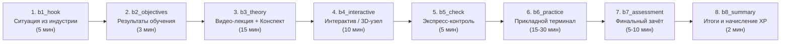

# УЧЕБНЫЙ ПЛАН ОБРАЗОВАТЕЛЬНОЙ ПЛАТФОРМЫ «АМК SKILLHUB» (EDUSPACE 2.0)

**Учебное заведение:** Алматинский многопрофильный колледж (АМК, г. Алматы, ул. Жандосова, 63)  
**Педагогическая модель:** Цикл экспериментального обучения Д. Колба + Таксономия Б. Блума (8-блочная интерактивная архитектура)  
**Дизайн-система и среда:** Google Stitch Edition / Gen-Z Cyber-Glass (`lesson_player.html`, `simulator.html`, WebGL 3D Engine)  
**Общий объём программы:** 5 специальностей × 20 недель (100 производственных уроков / 800 интерактивных блоков / 100 HD-видео / 25 3D-моделей)

---

## 1. Паспорт образовательных программ (Специальности ТиПО)

| № | Слаг (`slug`) | Код ГК РК | Наименование специальности | Куратор направления | Учебные группы | Длительность | Часы / XP |
|---|---|---|---|---|---|---|---|
| 1 | `it` | `06130100` | **Программное обеспечение (Web Design)** | Власов Михаил Григорьевич | ИС-21, ИС-22, ПО-22 | 12 недель (12 уроков) | 12.5 ак. ч / 865 XP |
| 2 | `graphic_design` | `02130100` | **Графический дизайн и мультимедиа** | Сейдахметова Алия Кайратовна | ДГ-21, ДГ-22 | 12 недель (12 уроков) | 14.0 ак. ч / 865 XP |
| 3 | `autoelectric` | `07161301` | **Техническое обслуживание и ремонт электрооборудования (Автоэлектрика)** | Жумабаев Руслан Маратович | АВ-21, АЭ-22 | 12 недель (12 уроков) | 14.5 ак. ч / 865 XP |
| 4 | `hvac` | `07130700` | **Монтаж и эксплуатация холодильно-компрессорных машин и установок** | Ахметов Тимур Болатович | ХО-21, ХО-22 | 12 недель (12 уроков) | 14.5 ак. ч / 865 XP |
| 5 | `automechanic` | `07161400` | **Техническое обслуживание и ремонт автотранспорта (Автомеханика)** | Садыков Ерлан Касымович | АМ-21, АМ-22 | 12 недель (12 уроков) | 14.0 ак. ч / 865 XP |

---

## 2. Методическая структура каждого урока (Стандарт 8 блоков)

Каждый из 60 уроков учебного плана выстроен по единому регламенту в [`curriculum_seeder.py`](file:///c:/Users/kazakh/Downloads/скиллхаб/curriculum_seeder.py) и [`lesson_player.html`](file:///c:/Users/kazakh/Downloads/скиллхаб/lesson_player.html):

### Распределение типов уроков, интерактивов и наград по номерам уроков (1–12):

* **Типы уроков (`lesson_type`):**
  * **Уроки 1–2:** `visual` (Визуально-концептуальное погружение)
  * **Уроки 3–8:** `practical` (Формирование прикладного навыка)
  * **Уроки 9–11:** `simulation` (Производственная симуляция повышенной сложности)
  * **Урок 12:** `exam` (Итоговый демонстрационный экзамен / Квалификационная защита)
* **Чередование виджетов в Блоке 4 (`b4_interactive`):**
  * **Уроки 1, 4, 7, 10:** `flip_cards` (3D-карточки с переворотом для терминов и нормативов)
  * **Уроки 2, 5, 8, 11:** `matching` (Двухколоночное сопоставление параметров и эффектов)
  * **Уроки 3, 6, 9, 12:** `sequence` (Технологическая последовательность регламентных шагов)
  * **Специальные 3D-сцены (`WorkshopModels` / `StarterLesson`):** активируются в ключевых узловых уроках (`it-7`, `graphic_design-8`, `autoelectric-3`, `autoelectric-8`, `hvac-1`, `automechanic-1`).
* **Шкала начисления опыта (`xp_reward`):**
  * **Уроки 1–4:** `+60 XP` (всего 240 XP)
  * **Уроки 5–11:** `+75 XP` (всего 525 XP)
  * **Урок 12 (Экзамен):** `+100 XP`
  * **Итого за курс:** `865 XP` (при полном прохождении всех 5 курсов — `4 325 XP`, ранг **Tier 6: Architect** / **Tier 7: Legend** с учётом бонусов и стриков).

---

## 3. Поурочный учебный план по специальностям (60 уроков)

---

### Направление 1. Программное обеспечение и Web Design (`it` • Код `06130100`)

**Куратор:** Власов Михаил Григорьевич  
**Целевые компетенции (Skills Matrix):**
1. `ps_ai` — Photoshop & Illustrator для веба: растровые баннеры 72 ppi, WebP/PNG и векторные SVG-иконки (Уроки 1–2).
2. `figma_ui` — Figma: фреймы 1440 px, модульные сетки 8px, Auto Layout, мастер-компоненты и состояния Default/Hover (Уроки 3–5).
3. `html_css` — Семантическая верстка HTML5, блочная модель CSS3 и адаптивная раскладка Flexbox (Уроки 6–8).
4. `basic_js` — Интерактивность DOM, адаптивная вёрстка `@media`, доступность A11y и дипломный проект (Уроки 9–12).

| № / Неделя | Тема урока | Сложность и время | Тип / Виджет Блока 4 | Инструментарий и стек | Критерии приёмки практической работы (`guidelines`) | Маркеры автопроверки (`required_tokens`) | XP |
|---|---|---|---|---|---|---|---|
| **Урок 1** (День 1) | **Photoshop для Web Design:** подготовка баннера для сайта и экспорт (72 ppi, WebP/PNG) | Базовый (60 мин) | `visual` / `flip_cards` + видео `it-1.mp4` | Adobe Photoshop, 72 ppi, форматы WebP / PNG / JPG | 1. Указан размер баннера в пикселях (1200×600 px) 2. Указано экранное разрешение 72 ppi 3. Выбран формат сохранения для сайта (WebP или PNG) | `72 ppi`, `webp`, `баннер`, `пиксел` | 60 XP |
| **Урок 2** (День 2) | **Illustrator для Web Design:** рисование векторной иконки и экспорт в SVG | Базовый (60 мин) | `visual` / `matching` + видео `it-2.mp4` | Adobe Illustrator, Pen Tool, формат SVG | 1. Задан размер холста 24×24 px 2. Использованы векторные фигуры или перо 3. Описан экспорт в чистый веб-формат SVG | `svg`, `24`, `вектор`, `иконк` | 60 XP |
| **Урок 3** (День 3) | **Figma с нуля:** создание первого фрейма (Frame) и сетка отступов 8px | Базовый (60 мин) | `practical` / `sequence` + видео `it-3.mp4` | Figma, клавиша `F` (Frame), Layout Grid, шаг 8px | 1. Указано создание фрейма шириной 1440 px 2. Описана 12-колоночная сетка с отступами 3. Упомянуто правило отступов кратных 8px | `figma`, `frame`, `1440`, `8px` | 60 XP |
| **Урок 4** (День 4) | **Figma Auto Layout:** создание удобных кнопок и карточек (`Shift + A`) | Базовый (60 мин) | `practical` / `flip_cards` + видео `it-4.mp4` | Figma, Auto Layout (`Shift + A`), Padding, Corner Radius | 1. Описано создание текста и применение `Shift + A` 2. Заданы внутренние отступы (`padding`) по бокам и высоте 3. Настроены цвет заливки Fill и скругление углов Corner Radius | `auto layout`, `padding`, `кнопк`, `скруглен` | 60 XP |
| **Урок 5** (День 5) | **Figma Components:** мастер-компоненты и варианты состояний (`Default` и `Hover`) | Базовый (60 мин) | `practical` / `matching` + видео `it-5.mp4` | Figma, Мастер-компонент (`Ctrl+Alt+K`), Variants, Hover | 1. Описано создание мастер-компонента из кнопки 2. Добавлено свойство вариантов Variants (State) 3. Настроены два состояния: Default и Hover при наведении | `компонент`, `hover`, `вариант`, `instance` | 75 XP |
| **Урок 6** (День 6) | **Знакомство с кодом:** базовая HTML-разметка страницы (`h1`, `p`, `img`, `button`) | Базовый (60 мин) | `practical` / `sequence` + видео `it-6.mp4` | HTML5, теги `<h1>`, `
`, ``, `<button>`, `<a>` | 1. Использован контейнер `
` или `<article>` 2. Присутствует картинка `` 3. Написаны заголовок `<h1>`/`<h2>`, текст `
` и кнопка `<button>` | `<div`, `<h2`, `
`, `<button` | 75 XP |
| **Урок 7** (День 7) | **Базовые стили CSS:** цвет текста, фон, отступы (`padding`, `margin`) и скругления углов | Базовый (60 мин) | `practical` / **3D-модель «Слои CSS-блока»** (`it-7`) | CSS3, `color`, `background`, `padding`, `margin`, `border-radius` | 1. Задан цвет фона `background` 2. Заданы внутренние отступы `padding` 3. Указано скругление углов `border-radius` и цвет текста `color` | `background`, `padding`, `border-radius`, `color` | 75 XP |
| **Урок 8** (День 8) | **Раскладка блоков Flexbox:** выравнивание логотипа и меню в шапке сайта (`Header`) | Базовый (60 мин) | `practical` / `matching` + видео `it-8.mp4` | CSS Flexbox, `display: flex`, `justify-content`, `align-items` | 1. Указано свойство `display: flex` 2. Использовано правило `justify-content: space-between` 3. Применено вертикальное центрирование `align-items: center` | `display: flex`, `justify-content`, `align-items`, `header` | 75 XP |
| **Урок 9** (День 9) | **Немного интерактива:** клик по кнопке на простом JavaScript (`addEventListener`) | Базовый (60 мин) | `simulation` / `sequence` + видео `it-9.mp4` | JavaScript ES6, `document.querySelector`, `addEventListener`, `alert` | 1. Использован метод поиска `document.querySelector` 2. Добавлен слушатель клика `addEventListener('click', ...)` 3. Вызвано действие `alert(...)` с текстом | `document.querySelector`, `addeventlistener`, `click`, `alert` | 75 XP |
| **Урок 10** (День 10) | **Итоговый проект Web Design:** верстка карточки продукта по макету из Figma (HTML + CSS) | Базовый (60 мин) | `simulation` / `flip_cards` + видео `it-10.mp4` | HTML5 + CSS3, макет Figma, `box-shadow`, `:hover` | 1. Написана HTML-разметка карточки с картинкой, заголовком и кнопкой 2. Применены CSS-стили со скруглением `border-radius` и тенью `box-shadow` 3. Добавлено изменение цвета кнопки при наведении `:hover` | `<div`, `class=`, `border-radius`, `hover` | 75 XP |
| **Урок 11** (День 11) | **Адаптивная вёрстка и цифровая доступность (A11y):** `@media`, `aria-label` и `:focus-visible` | Средний (60 мин) | `simulation` / `matching` + видео `it-11.mp4` | CSS `@media`, `aria-label`, `:focus-visible`, стандарт WCAG 2.1 | 1. Добавлено медиа-правило `@media (max-width: 768px)` 2. Настроен видимый контур фокуса `:focus-visible` 3. Использован атрибут `aria-label` для доступности элементов | `@media`, `max-width`, `focus-visible`, `aria-label` | 75 XP |
| **Урок 12** (День 12) | **Дипломная защита:** Сборка и публикация многосекционного адаптивного лендинга | Сложный (90 мин) | `exam` / `sequence` + видео `it-12.mp4` | HTML5, CSS Variables (`:root`), Flexbox/Grid, DevTools Audit | 1. Объявлены CSS-переменные дизайн-токенов в `:root` 2. Выполнена семантическая вёрстка `<header>`, `<main>`, `<section>` 3. Настроены адаптивный переход `@media` и интерактивный скрипт | `:root`, `<header`, `<main`, `@media` | 100 XP |

---

### Направление 2. Графический дизайн и мультимедиа (`graphic_design` • Код `02130100`)

**Куратор:** Сейдахметова Алия Кайратовна  
**Целевые компетенции (Skills Matrix):**
1. `composition` — Композиция, правило третей, колористика RGB/CMYK/Pantone и типографика (Уроки 1–3).
2. `branding` — Векторная графика (кривые Безье, Pathfinder), разработка логотипа, Brandbook и неразрушающая ретушь (Уроки 4, 5, 7).
3. `prepress` — Многостраничная вёрстка InDesign, штампы упаковки (Dieline), допечатная подготовка Prepress, SMM-система и защита брендбука (Уроки 6, 8, 9, 10, 11, 12).

| № / Неделя | Тема урока | Сложность и время | Тип / Виджет Блока 4 | Инструментарий и стек | Критерии приёмки практической работы (`guidelines`) | Маркеры автопроверки (`required_tokens`) | XP |
|---|---|---|---|---|---|---|---|
| **Урок 1** (День 1) | **Законы композиции:** правило третей и оптический баланс | Базовый (60 мин) | `visual` / `flip_cards` + видео `graphic_design-1.mp4` | Adobe Illustrator, Figma, модульная композиция | 1. Указан формат макета A3 и поля безопасности 2. Описана композиционная доминанта и правило третей 3. Выстроена визуальная иерархия 3 уровней | `доминант`, `трет`, `иерарх`, `мм` | 60 XP |
| **Урок 2** (День 2) | **Колористика и цветовые модели:** RGB для экранов vs CMYK и Pantone для печати | Базовый (60 мин) | `visual` / `matching` + видео `graphic_design-2.mp4` | Цветовой круг Иттена, профили ICC, RGB / CMYK / Pantone | 1. Приведены коды основного и акцентного цвета в HEX/RGB и пересчёт в CMYK 2. Указан плашечный аналог Pantone 3. Соблюдено правило мелкого текста `K:100` и лимит красок (TIL) до 300% | `rgb`, `cmyk`, `pantone`, `k:100` | 60 XP |
| **Урок 3** (День 3) | **Типографика:** классификация гарнитур, кернинг, трекинг и шрифтовые пары | Базовый (60 мин) | `practical` / `sequence` + видео `graphic_design-3.mp4` | Антиква и Гротеск, кернинг / интерлиньяж, типографическая сетка | 1. Выбрана гармоничная пара гарнитур (заголовки + основной набор) 2. Прописаны точные значения кегля (pt) и интерлиньяжа 3. Указаны настройки кернинга и трекинга для прописных рубрик | `кегл`, `интерлиньяж`, `кернинг`, `гротеск` | 60 XP |
| **Урок 4** (День 4) | **Векторная графика в Illustrator и CorelDRAW:** кривые Безье и булевы операции | Средний (60 мин) | `practical` / `flip_cards` + видео `graphic_design-4.mp4` | Illustrator, CorelDRAW, Pen Tool, Pathfinder / Shape Builder | 1. Описана модульная сетка и постановка узлов кривых Безье 2. Применены булевы операции Pathfinder (`Unite` / `Minus Front`) 3. Выполнены перевод шрифтов в кривые (`Create Outlines`) и разбор обводок (`Expand`) | `вектор`, `безье`, `pathfinder`, `крив` | 60 XP |
| **Урок 5** (День 5) | **Разработка логотипа:** охранное поле и руководство по фирменному стилю (Brandbook) | Средний (60 мин) | `practical` / `matching` + видео `graphic_design-5.mp4` | Айдентика бренда, охранное поле, Guideline / Brandbook | 1. Определены цветовые и монохромные версии логотипа 2. Задано правило расчёта охранного поля через модуль `X` и минимальный размер 3. Перечислены минимум 3 запрещённых приёма использования знака | `охранн`, `монохром`, `минимальн`, `пропорц` | 75 XP |
| **Урок 6** (День 6) | **Многостраничная вёрстка в Adobe InDesign:** мастер-шаблоны и модульные сетки | Средний (60 мин) | `practical` / `sequence` + видео `graphic_design-6.mp4` | Adobe InDesign, Master Pages (Parent), Paragraph Styles, Baseline Grid | 1. Задана сетка полосы набора (поля, число колонок и средник `gutter`) 2. Описана настройка Master/Parent страницы и колонцифр 3. Применены стили абзацев `Paragraph Styles` и приводная сетка `Baseline Grid` | `indesign`, `master`, `paragraph`, `baseline` | 75 XP |
| **Урок 7** (День 7) | **Растровая графика:** неразрушающая ретушь и обтравка в Adobe Photoshop | Средний (60 мин) | `practical` / `flip_cards` + видео `graphic_design-7.mp4` | Adobe Photoshop, Smart Objects, маски слоёв, Curves | 1. Указано рабочее разрешение 300 ppi для печатного постера 2. Применены Smart Objects и маски слоёв вместо стирания пикселей 3. Описана тоновая и цветовая посадка через корректирующие слои `Curves` | `300`, `smart object`, `маск`, `curves` | 75 XP |
| **Урок 8** (День 8) | **Дизайн упаковки и этикетки:** развёртка штампа (Dieline), вырубка и биговка | Сложный (90 мин) | `practical` / **3D-модель «Грани упаковки»** (`graphic_design-8`) | Конструкция упаковки, Dieline, рез/биговка, выборочный УФ-лак | 1. Разделены слои дизайна и векторного контура штампа (`Cut` + биговка с `Overprint`) 2. Оставлен свободным от краски/лака клеевой клапан и добавлены вылеты 3 мм 3. Предусмотрена светлая зона под штрихкод EAN-13 | `вырубк`, `биговк`, `overprint`, `клапан` | 75 XP |
| **Урок 9** (День 9) | **Допечатная подготовка (Prepress):** 300 dpi, вылеты под обрез 3 мм и стандарт PDF/X-1a | Сложный (90 мин) | `simulation` / `sequence` + видео `graphic_design-9.mp4` | Prepress-контроль, Acrobat Preflight, Bleeds 3 мм, Overprint, PDF/X-1a | 1. Проверены вылеты под обрез 3 мм и внутренние отступы безопасности 2. Подтверждены модель CMYK и эффективное разрешение растра 300 dpi 3. Указан экспорт в печатный стандарт `PDF/X` и проверка `Overprint` | `3 мм`, `300 dpi`, `cmyk`, `pdf/x` | 75 XP |
| **Урок 10** (День 10) | **Итоговый дипломный проект:** Комплексная айдентика и пакет носителей бренда | Сложный (90 мин) | `simulation` / `flip_cards` + видео `graphic_design-10.mp4` | Брендинг 360°, айдентика, носители печати и Digital | 1. Сформулирована идея и метафора визуальной айдентики бренда 2. Описаны константы стиля: знак, палитра RGB/CMYK и шрифтовая пара 3. Перечислен пакет носителей (печать + упаковка/мерч + digital) и форматы исходников | `концепц`, `логотип`, `носител`, `pdf` | 75 XP |
| **Урок 11** (День 11) | **Дизайн-система для Digital & SMM:** сетка шаблонов, баннеров и карточек маркетплейсов | Средний (60 мин) | `simulation` / `matching` + видео `graphic_design-11.mp4` | Figma / Photoshop, шаблоны 1080×1080 и 1080×1920 px, инфографика | 1. Указаны размеры форматов 1080×1080 px и 1080×1920 px с безопасными зонами 2. Задана модульная сетка и правила инфографики для карточки товара 3. Описан пакетный экспорт в sRGB (PNG / WebP) | `1080`, `1920`, `srgb`, `безопасн` | 75 XP |
| **Урок 12** (День 12) | **Квалификационная защита:** Презентация брендбука (Guideline) и передача пакета заказчику | Сложный (90 мин) | `exam` / `sequence` + видео `graphic_design-12.mp4` | InDesign / Figma / Acrobat Pro, полный Brandbook, архив Prepress + Digital | 1. Описана структура разделов итогового брендбука (знак, палитра, типографика, носители) 2. Зафиксирована структура каталогов чистового архива (`01_Logo`, `02_Print`, `03_Digital`) 3. Подтверждён финальный чек-лист: кривые, вылеты 3 мм, профили CMYK и sRGB | `брендбук`, `cmyk`, `3 мм`, `архив` | 100 XP |

---

### Направление 3. Автоэлектроника и компьютерная диагностика (`autoelectric` • Код `07161301`)

**Куратор:** Жумабаев Руслан Маратович  
**Целевые компетенции (Skills Matrix):**
1. `power_net` — Бортовая сеть 12/24 В, закон Ома, диагностика АКБ, стартеров и трёхфазных генераторов (Уроки 1–4).
2. `wiring_obd` — Чтение электросхем DIN 72552, компьютерная диагностика ЭБУ по OBD-II и кузовная электроника BCM/PWM (Уроки 5, 6, 9).
3. `can_osc` — Осциллография датчиков (ДПКВ/ДПРВ), мультиплексные шины CAN/LIN, поиск КЗ, иммобилайзер и комплексный аудит (Уроки 7, 8, 10, 11, 12).

| № / Неделя | Тема урока | Сложность и время | Тип / Виджет Блока 4 | Инструментарий и стек | Критерии приёмки практической работы (`guidelines`) | Маркеры автопроверки (`required_tokens`) | XP |
|---|---|---|---|---|---|---|---|
| **Урок 1** (День 1) | **Закон Ома:** расчёт сечения проводов и замер падения напряжения (Voltage Drop) | Базовый (60 мин) | `visual` / `flip_cards` + видео `autoelectric-1.mp4` | Цифровой мультиметр True RMS, закон Ома ($I = U / R$), таблица сечений | 1. Верно рассчитан рабочий ток по формуле $I = P / U$ (15 А) 2. Выбран номинал предохранителя с запасом (20 А) и сечение провода (2.5 мм²) 3. Указана методика проверки падения напряжения под нагрузкой (не более 0.2 В) | `15 а`, `20 а`, `2.5`, `падени` | 60 XP |
| **Урок 2** (День 2) | **Диагностика стартерных АКБ** и поиск паразитного тока утечки в режиме покоя | Базовый (60 мин) | `visual` / `matching` + видео `autoelectric-2.mp4` | Тестер АКБ (CCA / SOH), нагрузочная вилка, токовые клещи / амперметр | 1. Выполнена проверка АКБ (НРЦ 12.6+ В, остаточный пусковой ток CCA) 2. Соблюдены условия засыпания авто (закрытие замков/концевика капота, выдержка 20 мин) 3. Описана локализация цепи утечки в мА и устранение причины | `12.6`, `ма`, `предохранител`, `сна` | 60 XP |
| **Урок 3** (День 3) | **Диагностика и ремонт системы пуска:** стартер, втягивающее реле и редуктор | Средний (60 мин) | `practical` / **Спец-тренажер `StarterLesson` (Стенд пуска A-B-C-D)** | Мультиметр, клещи постоянного тока DC, стенд проверки стартеров | 1. Проверено наличие управляющего сигнала +12 В на клемме 50 и силового питания на болте 30 2. Измерено падение напряжения на массе двигателя и силовых пятаках втягивающего реле 3. Описана дефектовка щёточного узла, коллектора якоря и бендикса | `клемм`, `50`, `втягивающ`, `щётк` | 60 XP |
| **Урок 4** (День 4) | **Система зарядки:** диагностика трёхфазного генератора, диодного моста и реле-регулятора | Средний (60 мин) | `practical` / `flip_cards` + видео `autoelectric-4.mp4` | Мультиметр (диоды и AC/DC), осциллограф пульсаций, стенд генераторов | 1. Измерено напряжение на силовом выводе `B+` генератора и на АКБ (14.2 В) 2. Проверены сопротивление обмотки ротора (2.2–4.5 Ом) и целостность 3 фаз статора 3. Выполнена полярная проверка всех 6 диодов выпрямительного моста | `14.`, `b+`, `диодн`, `статор` | 60 XP |
| **Урок 5** (День 5) | **Чтение автомобильных электросхем DIN 72552:** реле и блоки предохранителей | Средний (60 мин) | `practical` / `matching` + видео `autoelectric-5.mp4` | Стандарт клемм DIN 72552, 4- и 5-контактные реле, контрольная лампа | 1. Проверено постоянное питание шины 30 и зажигания 15 2. Проверен управляющий минус от ЭБУ на выводе 85/86 и обмотка реле (70–100 Ом) 3. Выполнен запуск насоса подачей питания на вывод 87 и прозвонка проводки | `30`, `85`, `86`, `87` | 75 XP |
| **Урок 6** (День 6) | **Компьютерная диагностика ЭБУ по протоколу OBD-II:** коды DTC, Freeze Frame и Live Data | Средний (60 мин) | `practical` / `sequence` + видео `autoelectric-6.mp4` | Мультимарочный сканер OBD-II (DLC J1962), схемы питания ЭБУ (`5V Ref`) | 1. Проанализирован поток Live Data и выявлена просадка общей шины опорного питания 5 В 2. Использована электросхема распределения `5V Reference` по датчикам 3. Поочерёдным отключением разъёмов локализован замкнутый датчик и восстановлены 5.0 В | `5.0`, `live data`, `опорн`, `датчик` | 75 XP |
| **Урок 7** (День 7) | **Осциллографическая диагностика датчиков:** ДПКВ, ДПРВ, ДМРВ и лямбда-зонд | Сложный (90 мин) | `practical` / `flip_cards` + видео `autoelectric-7.mp4` | Автомобильный осциллограф / мотор-тестер, индуктивные датчики и Холла | 1. Описана форма и амплитуда сигнала ДПКВ (синусоида с пропуском 2 зубьев) и ДПРВ (меандр) 2. Проверено совпадение фаз синхронизации с эталоном по номеру зуба 3. Оценены диапазон переключения (0.1–0.9 В) и время отклика лямбда-зонда | `дпкв`, `холл`, `осциллограм`, `лямбд` | 75 XP |
| **Урок 8** (День 8) | **Диагностика мультиплексных сетей передачи данных:** CAN-High / CAN-Low и LIN | Сложный (90 мин) | `practical` / **3D-модель «Участок сети CAN»** (`autoelectric-8`) | Двухканальный осциллограф, мультиметр, витая пара CAN (ISO 11898) | 1. Выполнен замер сопротивления терминаторов на обесточенной шине (норма 60 Ом из двух по 120 Ом) 2. Проверено отсутствие замыкания CAN-High и CAN-Low на массу и на +12 В 3. Проанализирован дифференциальный сигнал 2.5→3.5 В / 2.5→1.5 В | `60 ом`, `120 ом`, `can-h`, `2.5` | 75 XP |
| **Урок 9** (День 9) | **Электрооборудование кузова (BCM):** LED-оптика с ШИМ (PWM), стеклоочистители и климат | Средний (60 мин) | `simulation` / `sequence` + видео `autoelectric-9.mp4` | Кузовной блок BCM, ШИМ-модуляция (PWM), сервоприводы заслонок | 1. Проверены силовое питание +12 В и масса под реальной нагрузкой на разъёме регулятора 2. Проверен управляющий ШИМ-сигнал (PWM) от панели климат-контроля 3. Выполнена дефектовка износа коллектора мотора отопителя | `шим`, `вентилятор`, `регулятор`, `питани` | 75 XP |
| **Урок 10** (День 10) | **Итоговый практический экзамен:** Поиск скрытого КЗ и ремонт жгута по заводскому стандарту | Сложный (90 мин) | `simulation` / `flip_cards` + видео `autoelectric-10.mp4` | Лампа-ограничитель КЗ, клеевая термоусадка, кримпер обжима пинов | 1. Применена безопасная методика поиска КЗ через лампу-ограничитель вместо предохранителя 2. По схеме разделены ветви потребителей и найдено перетирание изоляции в гофре 3. Выполнен ремонт с выносом стыков из зоны изгиба, обжимом гильзами и клеевой термоусадкой | `ламп`, `коротк`, `гофр`, `термоусадк` | 75 XP |
| **Урок 11** (День 11) | **Системы комфорта и безопасности:** диагностика иммобилайзера, центрального замка и шины LIN | Сложный (90 мин) | `simulation` / `matching` + видео `autoelectric-11.mp4` | Сканер (BCM / Immobilizer), осциллограф шины LIN, мультиметр | 1. Выполнен тест исполнительных механизмов со сканера для разделения силовой и сигнальной цепи 2. Проверена форма импульсов шины LIN (размах 1–12 В) 3. Локализован излом провода в гофре двери и проверен статус ключа иммобилайзера | `bcm`, `lin`, `гофр`, `иммобилайзер` | 75 XP |
| **Урок 12** (День 12) | **Квалификационный экзамен:** Комплексный диагностический протокол и ведомый поиск неисправности | Сложный (90 мин) | `exam` / `sequence` + видео `autoelectric-12.mp4` | Мотор-тестер, сканер OBD-II, мультиметр True RMS, диагностический протокол | 1. Сопоставлены коды DTC и данные Freeze Frame с инструментальными замерами 2. Подтверждена локализация потерь напряжения под нагрузкой на силовой массе ДВС 3. Выполнен контрольный перезамер зарядки (14.2 В) и проверка чистоты блоков после сброса DTC | `протокол`, `падени`, `масс`, `14.` | 100 XP |

---

### Направление 4. Холодильные системы и кондиционирование (`hvac` • Код `07130700`)

**Куратор:** Ахметов Тимур Болатович  
**Целевые компетенции (Skills Matrix):**
1. `thermo` — Термодинамический цикл на диаграмме $p\text{-}h$, хладагенты R600a/R134a/R404A, масла и расчёт Superheat/Subcooling (Уроки 1–4).
2. `brazing` — Высокотемпературная пайка меди с азотом, опрессовка контура, глубокая вакуумация (500 микрон) и заправка по весам (Уроки 5–8).
3. `electro_cold` — Диагностика пускозащитных реле и обмоток компрессоров, автоматика No Frost, контроллеры Eliwell, инверторные сплит-системы и паспорт ПНР (Уроки 4, 9, 10, 11, 12).

| № / Неделя | Тема урока | Сложность и время | Тип / Виджет Блока 4 | Инструментарий и стек | Критерии приёмки практической работы (`guidelines`) | Маркеры автопроверки (`required_tokens`) | XP |
|---|---|---|---|---|---|---|---|
| **Урок 1** (День 1) | **Термодинамика парокомпрессионного холодильного цикла** и фазовые переходы | Базовый (60 мин) | `visual` / **3D-модель «Узлы холодильного контура»** (`hvac-1`) | Диаграмма $p\text{-}h$ (давление-энтальпия), 4 базовых узла контура | 1. Перечислены 4 узла: компрессор, конденсатор, капилляр/ТРВ, испаритель 2. Указаны фазовые состояния хладагента на каждом участке 3. Сформулировано требование отсутствия жидкой фазы на всасывании (защита от гидроудара) | `компрессор`, `конденсатор`, `испарител`, `гидроудар` | 60 XP |
| **Урок 2** (День 2) | **Хладагенты R600a (Изобутан), R134a, R404A** и холодильные масла (Минеральное vs POE) | Базовый (60 мин) | `visual` / `matching` + видео `hvac-2.mp4` | Хладагенты R600a, R134a, R404A, R290; масла минеральные и синтетические POE | 1. Указаны термодинамические и экологические свойства R600a, R134a, R404A 2. Корректно сопоставлены масла (полиэфирное POE для R134a/R404A, минеральное для R600a) 3. Описаны требования пожаробезопасности и гигроскопичности POE | `r600a`, `r134a`, `poe`, `масл` | 60 XP |
| **Урок 3** (День 3) | **Диагностика по манометрическому коллектору:** расчёт перегрева (Superheat) и переохлаждения | Средний (60 мин) | `practical` / `sequence` + видео `hvac-3.mp4` | Манометрический коллектор (НД/ВД), контактный термометр, линейка P-T | 1. Верно рассчитан перегрев (Superheat): $(-2) - (-8) = 6\text{ K}$ (норма 4–8 K) 2. Верно рассчитано переохлаждение (Subcooling): $42 - 36 = 6\text{ K}$ (норма 3–7 K) 3. Сделан аргументированный вывод о корректной заправке контура | `перегрев`, `переохлажден`, `superheat`, `subcooling` | 60 XP |
| **Урок 4** (День 4) | **Электродвигатели мотор-компрессоров:** обмотки C, S, R и пускозащитные реле | Базовый (60 мин) | `practical` / `flip_cards` + видео `hvac-4.mp4` | Мультиметр, мегаомметр, пусковая/рабочая обмотки, позисторное реле PTC | 1. Идентифицированы выводы: 1 — C (общий), 2 — S (пусковая 32 Ом), 3 — R (рабочая 14 Ом) 2. Проверено правило $R_{S\text{-}R} = R_{C\text{-}S} + R_{C\text{-}R}$ ($46 = 32 + 14\text{ Ом}$) 3. Описана проверка отсутствия пробоя на корпус и сопротивление таблетки PTC (15–30 Ом) | `обмотк`, `ptc`, `пусков`, `рабоч` | 60 XP |
| **Урок 5** (День 5) | **Сварочно-паечные работы:** пайка меди медно-фосфорным и серебряным припоем | Средний (60 мин) | `practical` / `matching` + видео `hvac-5.mp4` | Кислородно-пропановый пост, припои CuP и ПСр-30/45 (Ag), сухой азот | 1. Использованы роликовый труборез и гратосниматель/риммер без попадания стружки внутрь 2. Разграничены припои: медно-фосфорный CuP для меди и серебряный Ag с флюсом для стали 3. Описана продувка азотом против окалины и теплоотвод влажной ветошью | `пайк`, `припой`, `азот`, `фильтр` | 75 XP |
| **Урок 6** (День 6) | **Опрессовка контура азотом:** поиск утечек и устранение микротрещин | Средний (60 мин) | `practical` / `sequence` + видео `hvac-6.mp4` | Баллон сухого азота с редуктором ВД, электронный течеискатель, УФ-лампа | 1. Разделены контуры низкой стороны (10 бар) и высокой стороны / петли обогрева (18 бар) 2. Использован сухой азот через редуктор с контролем падения давления по времени 3. Локализована утечка в контуре обогрева двери и выполнено её устранение | `азот`, `опрессовк`, `утечк`, `бар` | 75 XP |
| **Урок 7** (День 7) | **Глубокое вакуумирование контура** двухступенчатым насосом и контроль вакуумметром | Средний (60 мин) | `practical` / `flip_cards` + видео `hvac-7.mp4` | Двухступенчатый вакуумный насос, электронный вакуумметр (микроны / Па) | 1. Подключён двухступенчатый вакуумный насос и цифровой вакуумметр 2. Достигнут целевой глубокий вакуум 500 микрон (ниже 100 Па) 3. Проведён тест удержания вакуума после закрытия вентилей | `вакуум`, `микрон`, `насос`, `влаг` | 75 XP |
| **Урок 8** (День 8) | **Заправка хладагента по электронным весам** в граммах и замена фильтра-осушителя | Сложный (90 мин) | `practical` / `matching` + видео `hvac-8.mp4` | Электронные заправочные весы ($\pm 1\text{ г}$), фильтр-осушитель, клещи Pinch-off | 1. Взята точная паспортная норма заправки с шильдика (54 г R600a) 2. Продута заправочная линия перед пуском хладагента 3. Проконтролирован выход на режим без обмерзания всаса и выполнено пережатие аппендикса | `54`, `вес`, `r600a`, `обмерзан` | 75 XP |
| **Урок 9** (День 9) | **Электросхемы систем No Frost:** таймер оттайки, ТЭН, термопредохранитель и биметалл | Сложный (90 мин) | `simulation` / `sequence` + видео `hvac-9.mp4` | Мультиметр, биметаллический дефрост-термостат, ТЭН оттайки, таймер No Frost | 1. Измерено сопротивление нагревателя ТЭНа оттайки (норма 200–400 Ом) 2. Проверена целостность плавкого термопредохранителя (0 Ом) и замыкание биметалла при минусе 3. Проверено переключение таймера между режимами «Охлаждение» и «Оттайка» | `тэн`, `таймер`, `no frost`, `биметалл` | 75 XP |
| **Урок 10** (День 10) | **Итоговый сервисный кейс:** Диагностика, ремонт и пусконаладка торговой холодильной витрины | Сложный (90 мин) | `simulation` / `flip_cards` + видео `hvac-10.mp4` | Микропроцессорный контроллер Eliwell / Carel, акт дефектовки и пусконаладки | 1. Указаны параметры вакуумирования (500 микрон) и заправка фреоном строго по весам 2. Зафиксированы рабочие давления кипения и конденсации по манометрам 3. Описано программирование контроллера Eliwell (`Set Point`, дифференциал `Hy`) и сдача витрины | `eliwell`, `контроллер`, `витрин`, `вакуум` | 75 XP |
| **Урок 11** (День 11) | **Инверторные сплит-системы и кондиционеры:** диагностика платы IPM, ЭРВ и датчиков NTC | Сложный (90 мин) | `simulation` / `matching` + видео `hvac-11.mp4` | Мультиметр, таблица R-T термисторов NTC (10 кОм), тестер инвертора, ЭРВ (EEV) | 1. Выполнена проверка сопротивления термистора NTC при 25 °C со сверкой с таблицей 2. Проверены катушки шагового двигателя ЭРВ и диодный тест модуля IPM 3. Соблюдён регламент разряда конденсаторов DC-шины перед замерами | `ntc`, `инвертор`, `ipm`, `эрв` | 75 XP |
| **Урок 12** (День 12) | **Квалификационный экзамен:** Паспорт пусконаладочных работ (ПНР) и сдача холодильной установки | Сложный (90 мин) | `exam` / `sequence` + видео `hvac-12.mp4` | Коллектор, вакуумметр, весы, токовые клещи, термоанемометр, акт ПНР | 1. Внесены в акт ПНР результаты опрессовки азотом, вакуумирования (500 микрон) и массы заправки 2. Рассчитаны и подтверждены перегрев (6 K), переохлаждение (5 K) и температурный перепад воздуха ($\Delta T = 12\text{ K}$) 3. Проверен рабочий ток компрессора относительно номинала FLA и оформлен допуск к эксплуатации | `пнр`, `микрон`, `перегрев`, `переохлажден` | 100 XP |

---

### Направление 5. Автомеханика и ТО автотранспорта (`automechanic` • Код `07161400`)

**Куратор:** Садыков Ерлан Касымович  
**Целевые компетенции (Skills Matrix):**
1. `engine` — Диагностика ДВС (компрессия, пневмотест), фазы ГРМ, прецизионная дефектовка ЦПГ микрометром/нутромером, смазка и охлаждение (Уроки 1–4).
2. `chassis` — Сцепление и МКПП, диагностика ходовой части и регулировка углов установки колёс на 3D-стенде сход-развала (Уроки 5–7).
3. `brakes_to` — Тормозная система, шиномонтаж/балансировка, регламентное ТО-2, обслуживание ШРУС/приводов и комплексная приёмка автомобиля (Уроки 8–12).

| № / Неделя | Тема урока | Сложность и время | Тип / Виджет Блока 4 | Инструментарий и стек | Критерии приёмки практической работы (`guidelines`) | Маркеры автопроверки (`required_tokens`) | XP |
|---|---|---|---|---|---|---|---|
| **Урок 1** (День 1) | **Диагностика механической части двигателя:** замер компрессии и пневмотестирование (Leak-Down Test) | Базовый (60 мин) | `visual` / **3D-модель «Разрез цилиндра ДВС»** (`automechanic-1`) | Компрессометр резьбовой, пневмотестер утечек надпоршневого пространства | 1. Описаны условия замера компрессии (прогретый ДВС, открытый дроссель, отключённая подача топлива) 2. Проведён дифференциальный анализ масляной пробы в проблемном цилиндре 3. Локализована утечка пневмотестером (прогар выпускного клапана vs износ колец) | `компресси`, `пневмотест`, `клапан`, `бар` | 60 XP |
| **Урок 2** (День 2) | **Газораспределительный механизм (ГРМ):** метки, натяжители и регулировка тепловых зазоров клапанов | Базовый (60 мин) | `visual` / `matching` + видео `automechanic-2.mp4` | Набор плоских щупов (0.05–1.00 мм), фиксаторы валов ГРМ, динамометрический ключ | 1. Указаны заводские допуски тепловых зазоров на холодном ДВС: впуск 0.20 мм, выпуск 0.30 мм 2. Приведена формула расчёта толщины регулировочной шайбы/толкателя: $N = T + (E - C)$ 3. Описан регламент затяжки бугелей распредвала динамометрическим ключом | `грм`, `зазор`, `щуп`, `метк` | 60 XP |
| **Урок 3** (День 3) | **Дефектовка ЦПГ и коленчатого вала:** микрометр, индикаторный нутромер и Plastigauge | Сложный (90 мин) | `practical` / `sequence` + видео `automechanic-3.mp4` | Микрометр (0–75 мм), индикаторный нутромер, калиброванная проволока Plastigauge | 1. Зафиксированы замеры гильзы цилиндра нутромером в 3 поясах и 2 плоскостях 2. Сделан вывод о превышении допуска эллипсности/конусности и назначена расточка в ремонтный размер `+0.50 мм` 3. Подтверждён масляный зазор вкладышей методом Plastigauge (0.038 мм) | `нутромер`, `микрометр`, `овальн`, `plastigauge` | 60 XP |
| **Урок 4** (День 4) | **Диагностика и обслуживание систем смазки и охлаждения ДВС** | Средний (60 мин) | `practical` / `flip_cards` + видео `automechanic-4.mp4` | Механический манометр давления масла, рефрактометр антифриза, опрессовщик СОД | 1. Выполнен контрольный замер давления масла механическим манометром на ХХ и при 3000 об/мин 2. Выявлена причина падения давления (засорение маслоприёмника герметиком) 3. Проведена опрессовка системы охлаждения давлением 1.3 бар и проверка плотности антифриза рефрактометром | `давлен`, `масло`, `манометр`, `охлажден` | 60 XP |
| **Урок 5** (День 5) | **Сцепление и МКПП:** дефектовка корзины, ведомого диска, выжимного подшипника и маховика | Средний (60 мин) | `practical` / `matching` + видео `automechanic-5.mp4` | Штангенциркуль, оправка центровки диска сцепления, индикатор часового типа | 1. Измерена глубина заклёпок фрикционных накладок диска (менее 0.3 мм — предельный износ) 2. Оценена выработка лепестков диафрагменной пружины корзины и состояние выжимного подшипника 3. Проверен люфт маховика и выполнена сборка с центровкой оправкой | `сцеплен`, `диск`, `корзин`, `маховик` | 75 XP |
| **Урок 6** (День 6) | **Подвеска и ходовая часть:** диагностика сайлентблоков, шаровых опор, амортизаторов и ступиц | Средний (60 мин) | `practical` / `sequence` + видео `automechanic-6.mp4` | Монтажная лопатка, индикатор часового типа, стяжки витых пружин | 1. Выявлен осевой/радиальный люфт шаровой опоры под нагрузкой 2. Диагностирован гул ступичного подшипника с передачей вибрации на виток пружины 3. Зафиксировано правило окончательной затяжки сайлентблоков только под собственным весом автомобиля | `подвеск`, `сайлентблок`, `шаров`, `ступиц` | 75 XP |
| **Урок 7** (День 7) | **Углы установки колёс:** 3D сход-развал (Развал Camber, Кастор Caster, Схождение Toe) | Сложный (90 мин) | `practical` / `flip_cards` + видео `automechanic-7.mp4` | Стенд 3D сход-развала с оптическими мишенями, поворотные круги, депрессор педали тормоза | 1. Выполнена процедура компенсации биения дисков прокатыванием (`Run-out`) 2. Выставлены углы Кастора (`Caster`), Развала (`Camber`) и Схождения (`Toe`) в зелёный сектор допусков 3. Зафиксировано рулевое колесо строго в горизонт перед контрением рулевых тяг | `сход-развал`, `camber`, `кастор`, `схожден` | 75 XP |
| **Урок 8** (День 8) | **Тормозная система:** биение тормозных дисков, ревизия суппортов и прокачка контура ABS | Базовый (60 мин) | `practical` / `matching` + видео `automechanic-8.mp4` | Индикатор часового типа на магнитной стойке, микрометр, установка прокачки тормозов | 1. Замерена остаточная толщина диска микрометром и торцевое биение индикатором 2. Выявлена причина пульсации педали (биение 0.09 мм при допуске до 0.05 мм) 3. Описана чистка/смазка направляющих суппорта профильной пастой и замена жидкости DOT-4 | `тормозн`, `биен`, `суппорт`, `dot` | 75 XP |
| **Урок 9** (День 9) | **Шиномонтаж и балансировка колёс:** статический и динамический дисбаланс | Базовый (60 мин) | `simulation` / `sequence` + видео `automechanic-9.mp4` | Шиномонтажный и балансировочный станки, динамометрический ключ | 1. Соблюдена посадка шины по стрелке `Rotation` (или метке `Outside`) и совмещение цветовой точки с вентилем 2. Выполнена двухплоскостная динамическая балансировка в `0 / 0 г` 3. Произведена затяжка колёсных болтов динамометрическим ключом крест-накрест (120 Н·м) | `балансировк`, `динамометрическ`, `дисбаланс`, `н·м` | 75 XP |
| **Урок 10** (День 10) | **Регламентное техническое обслуживание (ТО-1 / ТО-2)** и составление заказ-наряда | Сложный (90 мин) | `simulation` / `flip_cards` + видео `automechanic-10.mp4` | Технологическая карта ТО, электронный динамометрический ключ, бланк заказ-наряда СТО | 1. Оформлен полный чек-лист операций ТО-2 (замена масла ДВС, фильтров, свечей зажигания, тормозной жидкости) 2. Приведены точные инструментальные замеры (остаток колодок в мм, температура кристаллизации антифриза, протектор) 3. Заполнен чистовой заказ-наряд с перечнем работ, запчастей и рекомендаций клиенту | `заказ-наряд`, `то-2`, `масло`, `фильтр` | 75 XP |
| **Урок 11** (День 11) | **Приводные валы и ШРУС (CV Joints):** дефектовка трипоидов, замена пыльников и смазки | Средний (60 мин) | `simulation` / `matching` + видео `automechanic-11.mp4` | Клещи для ушковых хомутов (Oetiker), динамометрический ключ, смазки с $\text{MoS}_2$ и полимочевинная | 1. Разделены симптомы износа наружного шарикового ШРУСа и внутреннего трипоида 2. Разграничены типы смазок ($\text{MoS}_2$ для наружного и без дисульфида молибдена для трипоида) 3. Описана обтяжка хомутов пыльника и затяжка ступичной гайки под нагрузкой | `шруc`, `трипоид`, `пыльник`, `ступичн` | 75 XP |
| **Урок 12** (День 12) | **Квалификационный экзамен:** Комплексная дефектовка, контрольный осмотр и выпуск автомобиля из ремзоны | Сложный (90 мин) | `exam` / `sequence` + видео `automechanic-12.mp4` | Динамометрический ключ, рефрактометр, тестер тормозной жидкости, чек-лист ОТК | 1. Проведён предвыездной контроль моментов затяжки колёс (120 Н·м) и ответственного крепежа подвески 2. Подтверждены уровни технических жидкостей, отсутствие течей и прокачка педали тормоза перед выездом 3. Оформлено заключение ОТК о допуске автомобиля к безопасной эксплуатации | `120`, `динамометрическ`, `тормоз`, `допуск` | 100 XP |

---

## 4. Система контроля качества, экзаменационных билетов и геймификации

### 4.1. Два режима прохождения в платформе
1. 🎯 **Режим «Свободный выбор» (`tasks.html` / `lesson_player.html`):**
   * Последовательное открытие уроков по дням (`unlock_day: 1..12`) или свободная тренировка в интерактивном тренажере [`simulator.html`](file:///c:/Users/kazakh/Downloads/скиллхаб/simulator.html).
   * Сохранение прогресса каждого из 8 блоков в таблице `lesson_block_progress`.
2. ⭐ **Режим «Экзаменационные билеты преподавателя» (`simulator.html` / `teacher.html`):**
   * Назначение официальных демонстрационных экзаменационных билетов (**Билет №1**, **Билет №2**) с контролем таймера (`60` или `90` минут).
   * Двухконтурная проверка: автоматическая проверка по маркерам (`required_tokens` + `min_length`) + экспертная проверка преподавателем в электронном журнале [`gradebook.html`](file:///c:/Users/kazakh/Downloads/скиллхаб/gradebook.html) с помощью AI-ассистента рецензирования (`/api/ai/review_submission`).

### 4.2. Таблица квалификационных рангов студента (XP Ledger)

| Уровень | Ранг в системе | Порог XP | Соответствие освоению учебного плана |
|---|---|---|---|
| **LVL 1** | **Новичок (Novice)** | `0 XP` | Регистрация и старт обучения в АМК SkillHub |
| **LVL 2** | **Исследователь (Explorer)** | `200 XP` | Освоение базового блока специальности (Уроки 1–4) |
| **LVL 3** | **Практик (Practitioner)** | `500 XP` | Освоение основного курса одной специальности (Уроки 1–8) |
| **LVL 4** | **Специалист (Specialist)** | `1 000 XP` | Полное завершение 1 специальности (12 уроков = 865 XP + бонусы за идеальную сдачу) |
| **LVL 5** | **Мастер (Master)** | `1 500 XP` | Освоение 2 полных смежных специальностей колледжа + ежедневные квесты |
| **LVL 6** | **Архитектор (Architect)** | `3 000 XP` | Мультидисциплинарное освоение 4–5 направлений АМК |
| **LVL 7** | **Легенда АМК (Legend)** | `5 000+ XP` | Полное прохождение всех 60 уроков, тренажеров, билетов и серий ударных стриков |
