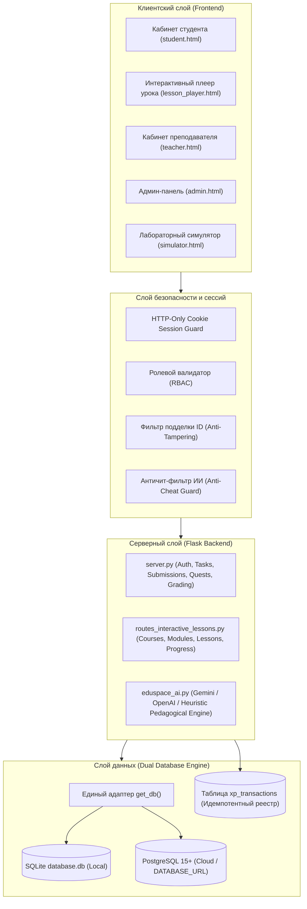

# EDUSPACE ARCHITECTURE

## 1. Концепция и обзор архитектуры
EduSpace 2.0 спроектирована как высоконадежная, модульная и безопасная образовательная веб-платформа с микросервисной организацией кода внутри монолитного ядра Flask. Архитектура ориентирована на максимальную отказоустойчивость, чистую изоляцию ролей и масштабируемость от локального стенда колледжа до распределенного облачного деплоя в PostgreSQL.

---

## 2. Архитектурная диаграмма системы

---

## 3. Детализация слоев

### 3.1. Клиентский слой (Presentation)
- **Технологический стек:** HTML5, Tailwind CSS, Material Symbols, Vanilla JavaScript (ES6+).
- **Специализированные плееры:**
  - `lesson_player.html`: Обеспечивает фокусное прохождение 8 образовательных блоков, анимированные карточки с переворотом (3D CSS perspective), интерактивное сопоставление терминов, экспресс-контроль с обратной связью и боковой Сократовский чат-интерфейс.
  - `simulator.html`: Содержит аппаратные и программные интерактивные тренажеры для 5 специальностей: веб-редактор с превью, графический холст с векторными примитивами, цифровой мультиметр с замером напряжения, контур кондиционера с манометрами, двигатель с замером компрессии.

### 3.2. Слой безопасности (Security & Session Management)
- **Аутентификация:** Идентификация по Email и защищенному 6-значному OTP-коду. Пароли хешируются с использованием SHA-256 / Bcrypt с солью.
- **Сессии:** Только `HttpOnly`, `SameSite=Lax`, `secure` (в production HTTPS).
- **Анти-темперинг:** Если авторизованный студент пытается передать чужой `user_id` в теле POST-запроса, сервер немедленно блокирует операцию с кодом HTTP 403 `TAMPERING_DETECTED` и заносит событие в журнал аудита.
- **Анти-чит ИИ:** Модуль `student_socratic_tutor` фильтрует прямые запросы готовых ответов и перенаправляет студента к самостоятельному размышлению через Сократовские подсказки.

### 3.3. Серверный слой (Business Logic)
- **`server.py`:** Базовый контроллер приложения: управление пользователями, демо-режимом, отправкой работ, матрицей оценок, журналами аудита, стриками и ежедневными квестами.
- **`routes_interactive_lessons.py`:** Модульный Blueprint, реализующий REST API для конструктора курсов, модулей, поблочного сохранения прогресса уроков и вызовов искусственного интеллекта.
- **`eduspace_ai.py`:** Серверный прокси к Gemini 1.5 Flash / OpenAI GPT-4o-mini с автоматическим переключением на встроенный детерминированный эвристический генератор при отсутствии внешних API ключей.

### 3.4. Слой данных (Persistence)
- **Dual Engine Architecture:**
  - Локальная разработка: SQLite `database.db`.
  - Продакшн деплой: PostgreSQL (через `psycopg2` / `DATABASE_URL`).
- **Идемпотентный финансово-игровой реестр (`xp_transactions`):**
  - Любое начисление XP привязано к уникальному ключу `(user_id, source_type, source_id)`.
  - Повторный вызов API гарантированно не дублирует опыт.
- **Таблица поблочного прогресса (`lesson_block_progress`):**
  - Хранит детальное состояние каждого блока (`state_json`) и статус прохождения (`completed`), гарантируя непрерывность образовательного процесса.
