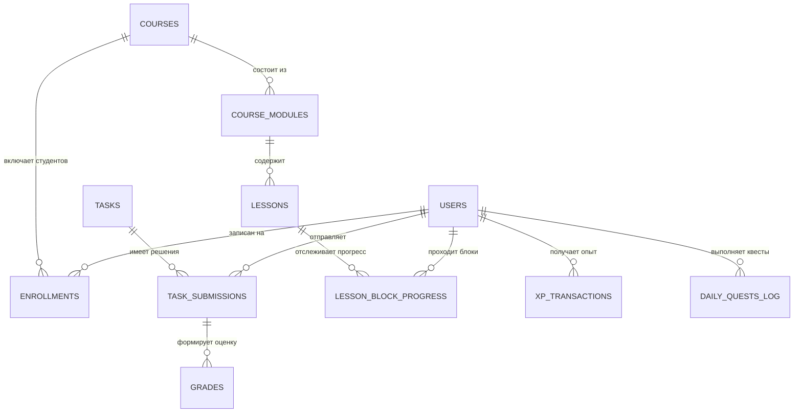

# EDUSPACE DATABASE

## 1. Обзор схемы базы данных
База данных платформы EduSpace 2.0 использует архитектуру Dual Engine:
- **Разработка и локальное тестирование:** SQLite 3 (`database.db`).
- **Продакшн развертывание:** PostgreSQL 15+ (через переменную окружения `DATABASE_URL`).

Схема полностью нормализована, снабжена внешними ключами (`FOREIGN KEY`) и уникальными составными индексами (`UNIQUE`), исключающими дублирование прогресса и накрутку очков опыта.

Всего в схеме **22 таблицы**.

---

## 2. Диаграмма связей ключевых сущностей (ERD)

---

## 3. Описание таблиц базы данных

### 3.1. Модульная система курсов и уроков (Новые таблицы EduSpace 2.0)

#### `courses` — Справочник учебных курсов
- `id` (INTEGER / SERIAL PRIMARY KEY): Идентификатор курса.
- `slug` (VARCHAR(64) UNIQUE NOT NULL): Уникальный слаг специальности (`it`, `graphic_design`, `autoelectric`, `hvac`, `automechanic` и др.).
- `title` (VARCHAR(255) NOT NULL): Официальное наименование курса.
- `code` (VARCHAR(64)): Код специальности по классификатору (например, `06130100`).
- `description` (TEXT): Развернутое описание образовательной программы.
- `curator_id` (INTEGER): Внешний ключ на преподавателя-куратора (`users.id`).
- `is_published` (INTEGER DEFAULT 1): Флаг публикации курса.
- `created_at` (TIMESTAMP): Дата создания.

#### `course_modules` — Тематические модули курса
- `id` (INTEGER / SERIAL PRIMARY KEY): Идентификатор модуля.
- `course_id` (INTEGER NOT NULL): Внешний ключ на `courses.id`.
- `title` (VARCHAR(255) NOT NULL): Наименование модуля.
- `order_num` (INTEGER DEFAULT 1): Порядковый номер модуля в курсе.
- `is_published` (INTEGER DEFAULT 1): Статус публикации.
- `created_at` (TIMESTAMP): Дата создания.

#### `lessons` — Интерактивные уроки
- `id` (INTEGER / SERIAL PRIMARY KEY): Идентификатор урока.
- `course_id` (INTEGER NOT NULL): Внешний ключ на `courses.id`.
- `module_id` (INTEGER): Внешний ключ на `course_modules.id`.
- `title` (VARCHAR(255) NOT NULL): Название урока.
- `lesson_type` (VARCHAR(64) DEFAULT 'theory'): Тип урока (`theory`, `practical`, `visual`, `simulation`, `case`, `assessment`).
- `order_num` (INTEGER DEFAULT 1): Порядковый номер в модуле.
- `xp_reward` (INTEGER DEFAULT 60): Награда в баллах опыта за завершение.
- `unlock_day` (INTEGER DEFAULT 1): День открытия по графику учебного процесса.
- `is_published` (INTEGER DEFAULT 1): Флаг публикации.
- `content_json` (TEXT DEFAULT '[]'): Полный массив 8 образовательных блоков урока в формате JSON.
- `created_at`, `updated_at` (TIMESTAMP): Метки времени создания и правки.

#### `lesson_block_progress` — Поблочный прогресс студента
- `id` (INTEGER / SERIAL PRIMARY KEY): Идентификатор записи.
- `user_id` (INTEGER NOT NULL): Студент (`users.id`).
- `lesson_id` (INTEGER NOT NULL): Урок (`lessons.id`).
- `block_id` (VARCHAR(64) NOT NULL): Идентификатор блока (`b1_hook`, `b4_interactive`, `b5_check` и т.д.).
- `completed` (INTEGER DEFAULT 0): Флаг завершения блока (1/0).
- `state_json` (TEXT DEFAULT '{}'): Сохраненное состояние (выбранные ответы, перевернутые карточки, код решения).
- `updated_at` (TIMESTAMP): Время последнего взаимодействия.
- **Ограничение:** `UNIQUE(user_id, lesson_id, block_id)`.

#### `ai_conversations` — Журнал взаимодействий с ИИ
- `id` (INTEGER / SERIAL PRIMARY KEY): Идентификатор диалога.
- `user_id` (INTEGER NOT NULL): Пользователь.
- `context_type` (VARCHAR(64) NOT NULL): Контекст вызова (`lesson_tutor`, `teacher_generator`, `submission_review`).
- `context_id` (VARCHAR(128)): Идентификатор урока или задания.
- `user_message` (TEXT NOT NULL): Текст запроса.
- `assistant_message` (TEXT NOT NULL): Ответ ИИ.
- `created_at` (TIMESTAMP): Время обращения.

---

### 3.2. Пользователи, геймификация и аудит

#### `users`
Хранит профили студентов, преподавателей и администраторов с разделением ФИО (`last_name`, `first_name`, `middle_name`), группой (`group_name`), балансом опыта (`bonus_xp`), стриком дней (`streak_days`) и списком разблокированных достижений (`achievements_json`).

#### `xp_transactions` (Идемпотентный финансовый реестр)
- `id`: Первичный ключ.
- `user_id`: Пользователь.
- `amount`: Количество начисленных XP.
- `source_type`: Источник начисления (`interactive_lesson`, `quiz_pass`, `task_submission`, `daily_quest`).
- `source_id`: Уникальный идентификатор события (например: `lesson_1_complete`, `quest_pass_quiz_2026-11-06`).
- `description`: Описание операции.
- `created_at`: Метка времени.
- **Ограничение уникальности:** `UNIQUE(user_id, source_type, source_id)`. Повторное начисление невозможно физически на уровне СУБД.

#### `daily_quests_log`
Хранит прогресс выполнения ежедневных заданий: `UNIQUE(user_id, quest_key, quest_date)`.

#### `audit_logs`
Нестираемый журнал действий: фиксация создания курсов, выставления оценок, изменения ролей и попыток несанкционированного доступа.

---

## 4. Миграции и репликация
Скрипт `migrate_to_postgres.py` обеспечивает автоматическую синхронизацию структуры и данных из SQLite в PostgreSQL при миграции на облачные сервера Render / Railway / Heroku.
