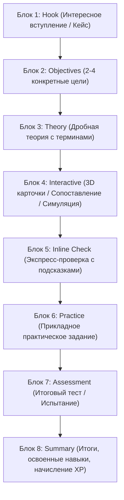

# EDUSPACE LESSON SYSTEM

## 1. Педагогическая философия интерактивного обучения
EduSpace принципиально отвергает формат «длинная стена текста с тестом на запоминание в конце». Каждый урок в EduSpace строится как сбалансированное цифровое учебное приключение, вовлекающее студента с первых секунд и стимулирующее постоянное действие.

Учебный процесс следует циклу Колба и таксономии Блума:
**Вовлечение (Hook) → Осмысление (Objectives) → Понимание (Theory) → Исследование (Interactive Widget) → Экспресс-проверка (Inline Check) → Применение (Practice) → Валидация (Assessment Quiz) → Награда и рефлексия (Summary & XP).**

---

## 2. Стандартная 8-блочная структура урока

---

## 3. Детальное описание каждого блока

### Блок 1. Hook (Интересное вступление)
- **Назначение:** Захватить внимание студента через реальную производственную ситуацию, дилемму или профессиональный вызов вместо сухих определений.
- **Пример:** «Представьте, что 65% пользователей покидают интернет-магазин в первую секунду, потому что не могут понять иерархию элементов. Как построить блочную модель так, чтобы интерфейс загружался молниеносно и был интуитивен?»
- **Поля JSON:** `id`, `type: "hook"`, `title`, `badge`, `content`.

### Блок 2. Objectives (Цели обучения)
- **Назначение:** Сформулировать 2–4 измеримых практических результата. Студент четко понимает, что он сможет делать руками после завершения урока.
- **Формат:** Нумерованные карточки компетенций.
- **Поля JSON:** `id`, `type: "objectives"`, `title`, `items: ["навык 1", "навык 2"]`.

### Блок 3. Theory (Изучение материала)
- **Назначение:** Разделение теории на компактные логические фрагменты (chunks) с визуальным выделением ключевых терминов и советов экспертов.
- **Особенности:** Включает плашки `callout` двух типов:
  - `tip` (совет эксперта, лучшие практики, предостережения);
  - `term` (четкое объяснение профессионального термина простыми словами).
- **Поля JSON:** `id`, `type: "theory"`, `title`, `chunks: [{ heading, text, callout: { type, title, text } }]`.

### Блок 4. Interactive Widget (Интерактивное взаимодействие)
- **Назначение:** Активное закрепление понятий через действия руками.
- **Поддерживаемые типы виджетов:**
  1. `flip_cards`: Карточки с 3D-переворотом на чистом CSS. Студент нажимает на карточку, чтобы проверить свое понимание термина.
  2. `matching`: Двухколоночный интерфейс сопоставления (понятие слева, эффект/значение справа) с цветовой индикацией совпадений.
  3. `sequence`: Интерактивная технологическая цепочка регламентных шагов.
  4. `simulation`: Встроенный интерактивный симулятор специальности (веб-код, векторный артборд, мультиметр, контур хладагента, ДВС).
- **Поля JSON:** `id`, `type: "interactive"`, `widget_type`, `title`, `cards` / `pairs` / `steps`.

### Блок 5. Inline Check (Проверка понимания)
- **Назначение:** Немедленная проверка понимания изученной части материала прямо в процессе, не откладывая до конца урока.
- **Педагогическая поддержка:**
  - Кнопка «Нужна подсказка?» разворачивает мягкий наводящий совет от тьютора;
  - При ошибке система не наказывает, а объясняет, *почему* выбранный вариант неверен, и напоминает ключевое правило;
  - При верном ответе подтверждает логику и открывает переход дальше.
- **Поля JSON:** `id`, `type: "inline_check"`, `title`, `question`, `options`, `correct_index`, `explanation`, `hint`.

### Блок 6. Practical Application (Практическое применение)
- **Назначение:** Выполнение прикладной задачи в условиях, приближенных к реальной работе.
- **Элементы:** Техническое задание, чек-лист критериев приёмки, редактор решения, кнопка локальной фиксации артефакта.
- **Поля JSON:** `id`, `type: "practical"`, `title`, `task_description`, `guidelines`.

### Блок 7. Assessment Quiz (Итоговое испытание)
- **Назначение:** Контрольный опрос из 2–4 вопросов по всем ключевым аспектам пройденного урока с подсчетом баллов.
- **Поля JSON:** `id`, `type: "assessment"`, `title`, `questions: [{ question, options, correct }]`.

### Блок 8. Summary & Reward (Результаты и опыт)
- **Назначение:** Фиксация успеха, демонстрация освоенных компетенций и начисление баллов опыта (XP) в профиль студента через идемпотентный реестр транзакций.
- **Поля JSON:** `id`, `type: "summary"`, `title`, `xp`, `skills_acquired`.

---

## 4. Конструктор уроков для преподавателя (No-Code Builder)
В кабинете преподавателя (`teacher.html`) реализован визуальный конструктор:
1. Выбор курса и модуля из выпадающих списков;
2. Настройка метаданных: Название, Тип урока (теория, практика, симуляция, кейс, экзамен), XP награда, День открытия, Статус публикации (Черновик / Опубликован);
3. Стек карточек блоков с кнопками перемещения Вверх / Вниз, удаления и редактирования содержимого по месту;
4. Выпадающее меню «+ Добавить блок» с готовыми шаблонами всех 8 типов блоков;
5. Кнопка «AI-Ассистент»: преподаватель вводит тему и цель, ИИ за секунды создает черновик урока из 8 блоков;
6. Кнопка «Предпросмотр»: открывает плеер урока в студенческом режиме для проверки верстки и логики перед публикацией.
