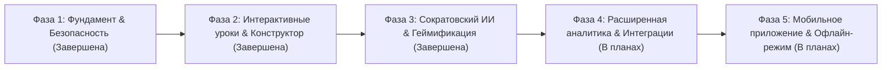

# EDUSPACE ROADMAP

## 1. Стратегический план развития платформы
План развития EduSpace разбит на последовательные фазы от MVP до масштабирования в масштабах колледжей и университетов.

---

## 2. Фазы дорожной карты

---

## 3. Детализация этапов

### Фаза 1. Безопасность, данные и устранение уязвимостей (Завершена)
- [x] Устранение обхода авторизации на админских и учительских маршрутах (HTTP 403).
- [x] Внедрение защиты от подделки идентификаторов (`TAMPERING_DETECTED`).
- [x] Изоляция групп преподавателей (проверка закрепления преподавателя за группой).
- [x] Идемпотентный реестр `xp_transactions` с защитой от накрутки.
- [x] Двухфакторная регистрация с 6-значным OTP по email.

### Фаза 2. Интерактивная система обучения (Завершена)
- [x] Проектирование и развертывание таблиц `courses`, `course_modules`, `lessons`, `lesson_block_progress`.
- [x] Создание универсальной 8-блочной структуры интерактивного урока (Hook, Objectives, Theory, Interactive, Inline Check, Practice, Assessment, Summary).
- [x] Реализация интерактивного плеера `lesson_player.html` с фокусировкой внимания и сохранением состояния.
- [x] Разработка визуального No-Code конструктора уроков для преподавателя в `teacher.html`.
- [x] Наполнение каталога стартовыми интерактивными курсами по 5 специальностям.

### Фаза 3. Искусственный интеллект и геймификация (Завершена)
- [x] Модуль `eduspace_ai.py` с поддержкой Gemini, OpenAI и детерминированного офлайн-движка.
- [x] Сократовский персональный ИИ-тьютор для студентов с античит-фильтром готовых ответов.
- [x] Генератор структуры уроков из 8 блоков для преподавателя.
- [x] Система 7 уровней мастерства, стриков, ежедневных квестов и 6 автоматических достижений.

### Фаза 4. Расширенная аналитика и интеграции (Следующий квартал)
- [ ] Экспорт журналов успеваемости в государственные системы (Kundelik, Platonus).
- [ ] Тепловые карты внимания студентов (на каких блоках уроков студенты проводят больше всего времени).
- [ ] Видеоконференцсвязь WebRTC прямо внутри плеера уроков для совместных разборов.
- [ ] Расширенная система командных заданий (peer-to-peer review).

### Фаза 5. Мобильное приложение и автономность (Перспективный план)
- [ ] PWA (Progressive Web App) с сервис-воркерами и кешированием уроков.
- [ ] Офлайн-прохождение уроков с локальным сохранением и отложенной синхронизацией при появлении сети.
- [ ] Push-уведомления о дедлайнах и стриках через Firebase Cloud Messaging.
